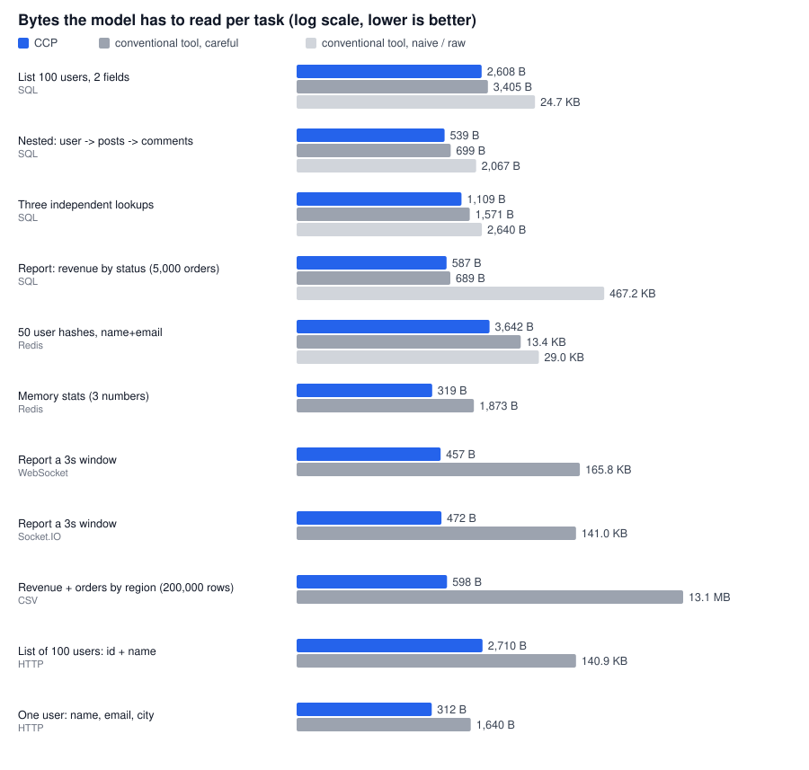

<div align="center">

# CCP — Core Context Protocol

**Give your AI the core context it needs. Nothing more.**

[](https://github.com/hacimertgokhan/ccp/actions/workflows/ci.yml)
[](LICENSE)


[Quick start](#quick-start) · [How it works](#how-it-works) · [Servers](#servers) · [Benchmark](#benchmark) · [Protocol](docs/PROTOCOL.md) · [Contributing](CONTRIBUTING.md)

</div>

---

AI agents burn most of their context window on data they never needed: whole
rows when they wanted two columns, one tool call per table, a schema repeated
on every request. **CCP** is a small protocol built around one idea — the model
should receive exactly the *core context* its question requires, in one round
trip.

```text
you ask   →  users(id:7){name posts{title comments{body}}}
you get   →  {users:[{name:"user7",posts:[{title:"quick brown fox",comments:[{body:"..."},...]}]}]}
```

One request. Only the fields you named. Related rows already nested inside.

## Why CCP

| | |
|---|---|
| **Ask for what you need** | Fields are chosen per request, so results carry no unused columns. |
| **Read the schema once** | The vocabulary is advertised a single time, not repeated on every call. |
| **Relations in one trip** | Foreign keys become nested fields: `users{posts{comments{...}}}`. |
| **Compact on the wire** | No quoted keys, no per-call envelope: fewer bytes, fewer tokens. |
| **Safe by construction** | Read-only, bound parameters, identifiers taken only from the database catalog. |
| **Drop-in for Claude** | Every CCP server is also a standard MCP server: one command to install. |

## Quick start

```bash
# 1. install the server for your database
cargo install --git https://github.com/hacimertgokhan/ccp mysql-ccp      # or postgres-ccp / sqlite-ccp

# 2. add it to Claude (one server per database)
claude mcp add shop \
  -e CCP_HOST=127.0.0.1 -e CCP_USER=readonly -e CCP_DBNAME=shop \
  -e CCP_PASSWORD="$DB_PASSWORD" \
  -- mysql-ccp
```

SQLite needs only a path: `claude mcp add notes -e CCP_PATH=/path/to/app.db -- sqlite-ccp`.

Claude now has two tools: `ccp_schema` (read once) and `ccp_query`. Ask it
something about your data and watch it send a single compact query.

Prefer to look first? `cargo run -p ccp -- demo` shows a query and its byte
cost with no database at all.

## Servers

All servers live in [`plugins/`](plugins) and share one engine ([`ccp-sql`](crates/ccp-sql)).

| Server | Database | Install | Connection |
|---|---|---|---|
| [`mysql-ccp`](plugins/mysql-ccp) | MySQL, MariaDB | `cargo install --git … mysql-ccp` | `CCP_HOST` `CCP_PORT`=3306 `CCP_USER` `CCP_PASSWORD` `CCP_DBNAME` |
| [`postgres-ccp`](plugins/postgres-ccp) | PostgreSQL | `cargo install --git … postgres-ccp` | `CCP_HOST` `CCP_PORT`=5432 `CCP_USER` `CCP_PASSWORD` `CCP_DBNAME` |
| [`sqlite-ccp`](plugins/sqlite-ccp) | SQLite file | `cargo install --git … sqlite-ccp` | `CCP_PATH` |

Want another database or data source (Redis, MongoDB, a REST API…)?
A server is about 150 lines: see [Writing a CCP server](docs/writing-a-server.md).

## How it works

```text
┌────────┐   MCP (stdio)    ┌──────────────┐   catalog + SELECT   ┌──────────┐
│ Claude │ ───────────────▶ │  *-ccp       │ ───────────────────▶ │ database │
└────────┘  ccp_query(...)  │  server      │ ◀─────────────────── └──────────┘
                            └──────────────┘
```

1. On first use the server **introspects** tables, columns, primary and foreign keys.
2. It advertises a **schema** the model reads once:
   ```text
   root users(limit:Int,offset:Int,id:Int,name:Str,...):[Users]
   type Users{id:Int,name:Str,...,posts:[Posts]}
   type Posts{id:Int,author_id:Int,title:Str,author:Users,comments:[Comments]}
   ```
3. Each question becomes **one query**. Only the requested columns are selected; nested
   relations are fetched in batches (`WHERE fk IN (...)`) rather than row by row.
4. The answer is encoded **compactly** and returned.

Query cheat sheet:

```text
users{id name}                          all users (limit 100), two fields
users(id:7){name email}                 filter by column equality
users(city:"Tokyo",limit:5,offset:10)   several filters + paging
posts(limit:20){title author{name}}     follow a foreign key forwards
users(id:7){posts{title comments{body}}} … or backwards, several levels deep
users(id:1){name} posts(author_id:1){id}  several roots in one call
_tables{name columns{name type}}        inspect the database itself
```

Full grammar and wire format: [docs/PROTOCOL.md](docs/PROTOCOL.md).

## Benchmark

Real CCP servers (over MCP, exactly as Claude drives them) against the usual
SQL-over-MCP shape (`list_tables` / `describe_table` / `query`, JSON rows),
on the same data: 1,000 users, 3,000 posts, 9,000 comments, identical results
verified on SQLite, MySQL/MariaDB and PostgreSQL.



| Task | CCP | SQL-MCP careful¹ | SQL-MCP naive² | Calls (CCP / careful / naive) |
|---|---:|---:|---:|---:|
| Point lookup, 2 fields | 270 B | 283 B | 471 B | 1 / 1 / 1 |
| 100 users, 2 fields | 2,608 B | 3,405 B | 25,259 B | 1 / 1 / 1 |
| 1,000 posts, id + title | 49,947 B | 57,944 B | 457,635 B | 1 / 1 / 1 |
| user → posts → comments | 539 B | 699 B | 2,067 B | 1 / 1 / 3 |
| 3 independent lookups | 1,109 B | 1,571 B | 2,640 B | 1 / 3 / 3 |
| **Whole agent session**³ | **7,326 B** | 9,330 B | 44,741 B | 7 / 12 / 15 |

¹ exact columns and a JOIN for related data  ² `SELECT *` and one query per table
³ setup + five typical questions. Token estimate bytes/4: **≈1.8k tokens vs ≈2.3k (careful) vs ≈11.2k (naive)**,
i.e. 22% / 84% fewer input tokens.

What to take from it, honestly: the huge wins come from *not over-fetching*
(up to 90% against `SELECT *`) and from one-call relations. A careful model
that always names columns closes much of the gap — CCP is still up to 29% smaller,
needs fewer calls (7 round trips instead of 12 per session), and removes the need to get that
right every time. Server latency is a few milliseconds (median 3–7 ms for a three-level query). Full tables, scaling and method:
[bench/RESULTS.md](bench/RESULTS.md); reproduce with `python3 bench/bench.py`.

## Security

* **Read-only**: sessions are opened read-only; only `SELECT` is ever generated.
* **No injection surface**: table/column names come from the database catalog,
  never from the caller; every value is a bound parameter.
* **Bounded**: 1,000 rows per root query, 10,000 per relation level, depth ≤ 4.
* **No secrets in output**: credentials are scrubbed from error messages.
* Use a dedicated read-only database user anyway, and note the connections are
  plain TCP for now (TLS is on the [roadmap](#roadmap)): use localhost or a tunnel.

Report vulnerabilities privately — see [SECURITY.md](SECURITY.md).

## Repository layout

```text
crates/
  ccp-proto/     the protocol: parser, executor, compact encoding (zero dependencies)
  ccp-sql/       shared engine for database servers: catalog, relations, SQL generation, MCP
  ccp/           demo CLI
plugins/         ready-to-use servers
  mysql-ccp/  postgres-ccp/  sqlite-ccp/
docs/            protocol spec, server-writing guide
bench/           reproducible benchmark
```

## Roadmap

- [ ] TLS for MySQL and PostgreSQL connections
- [ ] Aggregations and ordering (`count`, `order`)
- [ ] Nested arguments (`posts(limit:3)` inside a query)
- [ ] More servers: Redis, MongoDB, REST/OpenAPI
- [ ] Prebuilt release binaries and Homebrew tap

Ideas welcome: open an [issue](https://github.com/hacimertgokhan/ccp/issues/new/choose).

## Contributing

Contributions are very welcome — new database servers above all. Start with
[CONTRIBUTING.md](CONTRIBUTING.md) and [Writing a CCP server](docs/writing-a-server.md).

## License

[MIT](LICENSE) © 2026 Hacı Mert Gökhan
